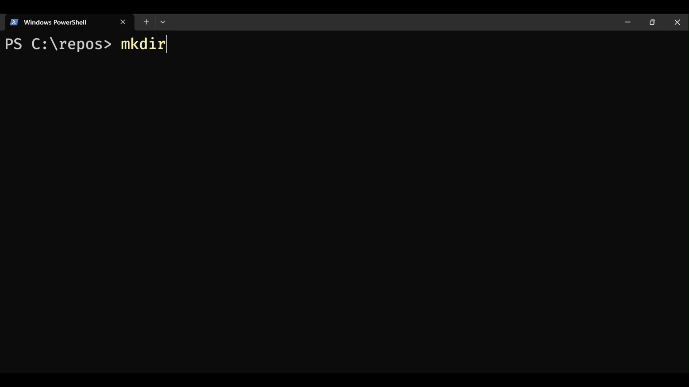

# Coding Harness

1. [Intro]()
2. [Architecture](#architecture)
3. [Installation](#installation)
4. [Usage](#usage)   
5. [Notes](#notes)

---
## Intro

This is a collection of workflows *mainly* for creating detailed plans and systematically executing them.  
Run each workflow by referencing its `.md` with an `@`.  



A consistent cycle of workflows is helpful for managing [context rot](https://www.trychroma.com/research/context-rot). 

For example, in the simplest case, the **PLAN**->**EXECUTE** workflow can be run like this:
```
/clear-context ➔ @resume.md ➔ @plan.md ➔ @pause.md ➔ /clear-context ➔ @resume.md ➔ @execute.md
```

<details>
<summary>Some examples of <b>Extended Workflows</b>:</summary>
<ul>
<li>Creating groups of plans with <i>PHASES</i>:
<ul><li><b>ADD-PHASE</b> ➔ <b>DISCUSS-PHASE</b> ➔ <b>PLAN</b> ➔ <b>EXECUTE</b> ➔ <b>VERIFY</b></li></ul>
</li>
<li>Handling unexpected changes:
<ul><li><b>INSERT-PHASE</b> ➔ <b>PLAN</b> ➔ <b>EXECUTE</b></li></ul>
</li>
<li>Grouping phases into <i>MILESTONES</i>:
<ul><li><b>NEW-MILESTONE</b> (generates list of phases) ➔ <b>PLAN {N}</b> ➔ <b>EXECUTE {N}</b> ➔ <b>VERIFY {N}</b> ➔ <b>AUDIT-MILESTONE</b> ➔ <b>COMPLETE-MILESTONE</b></li></ul>
</li>
<li>Specialized cycles for researching, auditing, verifying, and debugging.</li>
</ul>

> For trees of plans past 3 levels, it is recommended to tackle each list of milestones individually, clearing `SPEC.md` and `ROADMAP.md` after each project, then initializing from scratch by running `@new-project.md`.

</details>

---

## Architecture

The harness is organized entirely within the `.agent/` folder:

```text
.agent/
├── workflows/   # Callable workflows (@plan.md, @execute.md, etc.)
├── skills/      # Specific protocols (debugging, verification, mapping)
├── harness/     # Engineering rules, style guidelines, and templates
└── state/       # Project memory (SPEC.md, ROADMAP.md, phase history, debug logs)
```

---

## Installation

Run from within your target project's root directory:

<details>
<summary><b>macOS / Linux (Bash):</b></summary>

```bash
git clone --depth 1 https://github.com/OwenM31/Coding-Harness.git harness
cp -r harness/.agent .
rm -rf harness
```
</details>

<details>
<summary>
<b>Windows (PowerShell):</b></summary>

```powershell
git clone --depth 1 https://github.com/OwenM31/Coding-Harness.git harness
Copy-Item -Recurse harness\.agent .
Remove-Item -Recurse -Force harness
```
</details>

**Recommendation:** Commit this entire `.agent/` folder to version control.

---

## Usage

Inside your coding agent of choice, run `@help.md` to view a more detailed guide:

```text
@.agent/workflows/help.md
```

### Context Management 

The key tool in this harness for preventing **context rot** is the **pause ➔ clear-context ➔ resume** workflow:

```text
[Operation] ──▶ @pause.md ──▶ /clear-context ──▶ @resume.md ──▶ [Next Operation]
```

This sequence of workflows writes a summary of the agent's memory to `STATE.md`, clears the context window, and immediately reads that summary.

### Skills

The `.agent/skills/` directory contains 11 protocols (e.g., `debugger`, `empirical-validation`, `verifier`, and `codebase-mapper`). Agents consult these skills during workflow runs to perform tasks while managing context according to the principle of [progressive-disclosure](https://docs.claude-mem.ai/progressive-disclosure).

### Compatibility

Model-agnostic and compatible with any coding agent tool that supports prompt files or file mentions (`@`), including Claude Code, Codex, Google Antigravity / Gemini CLI, Cursor, Windsurf, and OpenCode.

---

## Notes

### Meta-Development & Scripts
The scripts located in `.agent/harness/scripts/` are meta-development utilities for maintaining and validating the harness itself (checking YAML, XML, etc.).

### TODO
* Add `update-harness.md` workflow that updates the current `.agent/` folder with the files currently available at the GitHub repo.
  * This should ignore the files that fall under "project memory", so that way the user can seamlessly continue using the harness without loosing their plans to an update.
* Add `customize-harness.md` workflow to start a conversation about sourcing specialized skills/tools for a task.
  * The workflow needs to integrate refrences to these new skills/tools into existing workflows.
* Add additional git workflow integration
  * Automatically prompt user to create new branch at the beginning of a milestone/phase, and remind to merge after verification.
  * Update `debug.md` workflow to utilize `git log`, `git bisect`, and `git blame` debugging techniques.

